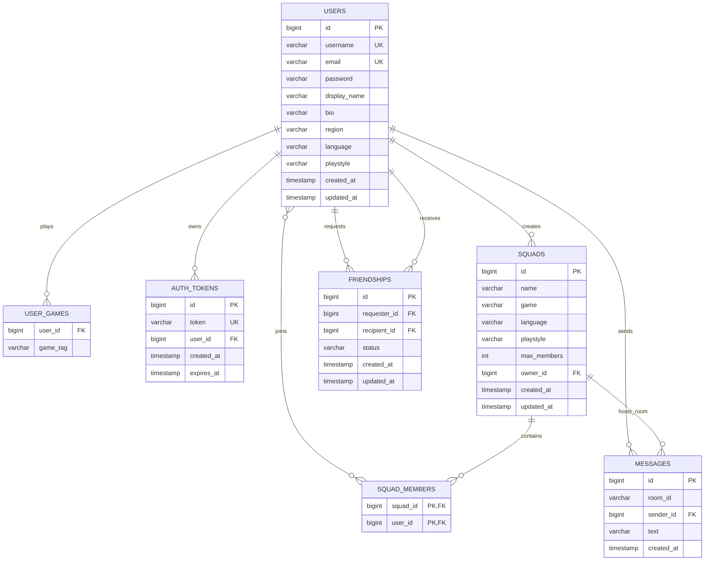

# SquadUp — Database Schema Specification

**Application**: SquadUp — Player Matching & Social Platform  
**Supported RDBMS**: MySQL 8 (Production) / H2 In-Memory & File-based (Development & Testing)  
**ORM / Persistence**: Spring Data JPA / Hibernate 6  
**Analytical Engine**: Spring JdbcTemplate (`PlatformStatsDao`)

---

## 1. Entity Relationship Overview

---

## 2. Table Definitions

### 2.1. `users` Table
Stores player identity, profile settings, and gaming preferences.

| Column | Type | Constraints | Description |
|---|---|---|---|
| `id` | `BIGINT` | `PRIMARY KEY`, `AUTO_INCREMENT` | Unique player identifier |
| `username` | `VARCHAR(50)` | `NOT NULL`, `UNIQUE` | Case-insensitive login identifier |
| `email` | `VARCHAR(100)` | `NOT NULL`, `UNIQUE` | Player contact and login alternate |
| `password` | `VARCHAR(255)` | `NOT NULL` | BCrypt-hashed password |
| `display_name` | `VARCHAR(100)` | `NULLABLE` | Public gamer display handle |
| `bio` | `VARCHAR(500)` | `NULLABLE` | Gamer biography and preferences |
| `region` | `VARCHAR(50)` | `NULLABLE` | Server region (NA, EU, ASIA, etc.) |
| `language` | `VARCHAR(50)` | `NULLABLE` | Primary spoken language for voice chat |
| `playstyle` | `VARCHAR(50)` | `NULLABLE` | Playstyle orientation: `Casual`, `Competitive`, `Ranked`, etc. |
| `created_at` | `TIMESTAMP` | `NOT NULL`, `DEFAULT CURRENT_TIMESTAMP` | Account creation timestamp |
| `updated_at` | `TIMESTAMP` | `NOT NULL`, `DEFAULT CURRENT_TIMESTAMP ON UPDATE CURRENT_TIMESTAMP` | Last profile update timestamp |

- **Indexes**:
  - `idx_users_username` on `username` (B-Tree)
  - `idx_users_email` on `email` (B-Tree)

---

### 2.2. `user_games` Table (ElementCollection)
Maps games played by each user for recommendation scoring.

| Column | Type | Constraints | Description |
|---|---|---|---|
| `user_id` | `BIGINT` | `NOT NULL`, `FOREIGN KEY REFERENCES users(id) ON DELETE CASCADE` | User reference |
| `game_tag` | `VARCHAR(100)` | `NOT NULL` | Game title (e.g., `Valorant`, `CS:GO`, `Apex Legends`) |

- **Indexes**:
  - `idx_user_games_user_id` on `user_id`
  - `idx_user_games_game_tag` on `game_tag`

---

### 2.3. `auth_tokens` Table
Maintains active 64-character bearer authentication tokens.

| Column | Type | Constraints | Description |
|---|---|---|---|
| `id` | `BIGINT` | `PRIMARY KEY`, `AUTO_INCREMENT` | Token record ID |
| `token` | `VARCHAR(64)` | `NOT NULL`, `UNIQUE` | High-entropy hex token string |
| `user_id` | `BIGINT` | `NOT NULL`, `FOREIGN KEY REFERENCES users(id) ON DELETE CASCADE` | Associated player ID |
| `created_at` | `TIMESTAMP` | `NOT NULL` | Token issuance timestamp |
| `expires_at` | `TIMESTAMP` | `NOT NULL` | Token expiration timestamp (TTL 24 hours) |

- **Indexes**:
  - `idx_auth_tokens_token` on `token` (B-Tree, unique lookup)
  - `idx_auth_tokens_user_id` on `user_id`

---

### 2.4. `squads` Table
Represents multiplayer "Looking for Group" lobby rooms.

| Column | Type | Constraints | Description |
|---|---|---|---|
| `id` | `BIGINT` | `PRIMARY KEY`, `AUTO_INCREMENT` | Squad lobby identifier |
| `name` | `VARCHAR(100)` | `NOT NULL` | Lobby title |
| `game` | `VARCHAR(100)` | `NOT NULL` | Game title |
| `language` | `VARCHAR(50)` | `NOT NULL` | Required communication language |
| `playstyle` | `VARCHAR(50)` | `NULLABLE` | Desired lobby playstyle |
| `max_members` | `INT` | `NOT NULL` | Maximum capacity limit (e.g., 2 to 10) |
| `owner_id` | `BIGINT` | `NOT NULL`, `FOREIGN KEY REFERENCES users(id)` | User ID of lobby host |
| `created_at` | `TIMESTAMP` | `NOT NULL` | Lobby creation timestamp |
| `updated_at` | `TIMESTAMP` | `NOT NULL` | Last update timestamp |

- **Indexes**:
  - `idx_squads_game` on `game`
  - `idx_squads_language` on `language`
  - `idx_squads_owner_id` on `owner_id`

---

### 2.5. `squad_members` Table (Join Table)
Many-to-many association mapping users who have joined squad lobbies.

| Column | Type | Constraints | Description |
|---|---|---|---|
| `squad_id` | `BIGINT` | `NOT NULL`, `FOREIGN KEY REFERENCES squads(id) ON DELETE CASCADE` | Squad lobby reference |
| `user_id` | `BIGINT` | `NOT NULL`, `FOREIGN KEY REFERENCES users(id) ON DELETE CASCADE` | Member reference |

- **Primary Key**: Composite `(squad_id, user_id)`
- **Concurrency Guard**: Synchronized via `@Lock(PESSIMISTIC_WRITE)` on `squads` row to prevent count exceeding `max_members`.

---

### 2.6. `friendships` Table
Tracks bidirectional social relationships and request states.

| Column | Type | Constraints | Description |
|---|---|---|---|
| `id` | `BIGINT` | `PRIMARY KEY`, `AUTO_INCREMENT` | Friendship record identifier |
| `requester_id` | `BIGINT` | `NOT NULL`, `FOREIGN KEY REFERENCES users(id) ON DELETE CASCADE` | User initiating request |
| `recipient_id` | `BIGINT` | `NOT NULL`, `FOREIGN KEY REFERENCES users(id) ON DELETE CASCADE` | User receiving request |
| `status` | `VARCHAR(20)` | `NOT NULL` | Status: `PENDING`, `ACCEPTED`, `REJECTED` |
| `created_at` | `TIMESTAMP` | `NOT NULL` | Request timestamp |
| `updated_at` | `TIMESTAMP` | `NOT NULL` | State transition timestamp |

- **Constraints**:
  - `UNIQUE(requester_id, recipient_id)`
- **Indexes**:
  - `idx_friendships_recipient` on `(recipient_id, status)`
  - `idx_friendships_requester` on `(requester_id, status)`

---

### 2.7. `messages` Table
Chat log history for squad lobbies and direct messaging rooms.

| Column | Type | Constraints | Description |
|---|---|---|---|
| `id` | `BIGINT` | `PRIMARY KEY`, `AUTO_INCREMENT` | Message log identifier |
| `room_id` | `VARCHAR(100)` | `NOT NULL` | Room destination (`squad_{id}` or `dm_{idA}_{idB}`) |
| `sender_id` | `BIGINT` | `NOT NULL`, `FOREIGN KEY REFERENCES users(id) ON DELETE CASCADE` | Player who sent message |
| `text` | `VARCHAR(2000)` | `NOT NULL` | Moderated message body |
| `created_at` | `TIMESTAMP` | `NOT NULL` | Timestamp message was persisted |

- **Indexes**:
  - `idx_messages_room_created` on `(room_id, created_at DESC)` for rapid paged history retrieval.

---

## 3. Concurrency & Transaction Management

1. **Pessimistic Write Locking (`@Lock(LockModeType.PESSIMISTIC_WRITE)`)**:
   - Implemented in `SquadService.join(Long userId, Long squadId)`.
   - Acquires an exclusive `SELECT ... FOR UPDATE` row lock on the target `squads` record.
   - Evaluates `squad.getMembers().size() < squad.getMaxMembers()`.
   - Prevents race conditions and guarantees lobbies never exceed max member limits under high concurrent load.
2. **Cascade Account Deletion Boundary (`@Transactional`)**:
   - Handled in `UserServiceImpl.deleteAccount(Long userId)`.
   - Sequentially removes:
     1. Associated auth tokens (`AuthTokenRepository`).
     2. Friendships where user is requester or recipient (`FriendshipRepository`).
     3. Squad memberships (`squad_members`).
     4. Deletes squads owned by the user.
     5. Purges sent messages (`MessageRepository`).
     6. Deletes user record (`UserRepository`).
   - Guarantees complete atomic cleanup without orphaned records.
