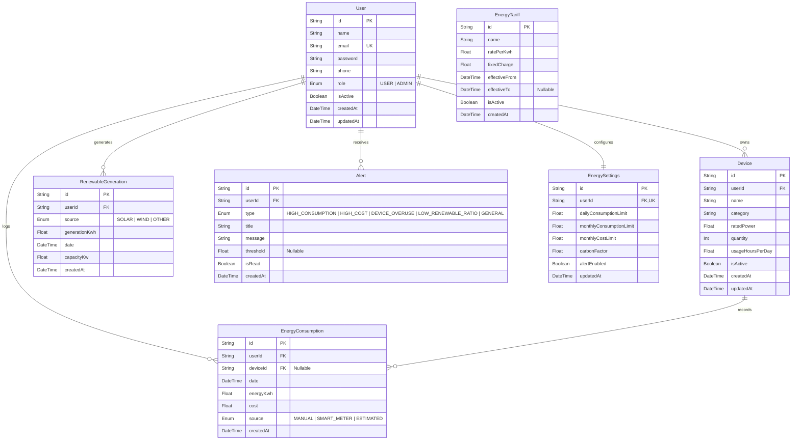

# Green Grid — Database Schema Specification

**RDBMS**: PostgreSQL 18  
**ORM**: Prisma ORM  
**Database**: `greengrid`

---

## 1. Entity Relationship Diagram

---

## 2. Table Specifications & Indexes

### `User`
- `id`: CUID primary key
- `email`: Unique index (`@@index([email])`)
- `role`: Index (`@@index([role])`)
- Cascades deletion to Devices, Consumptions, RenewableGenerations, Alerts, and Settings.

### `Device`
- `ratedPower`: Stored in Watts.
- `dailyConsumption`: Calculated on read as `(ratedPower * quantity * usageHoursPerDay) / 1000` (kWh).
- `userId`: Foreign key with `@@index([userId])`.

### `EnergyConsumption`
- `userId`, `date`: Composite index `@@index([userId, date])` for high-speed chronological range scans.
- `deviceId`: Nullable foreign key for aggregate and device-specific logs.

### `RenewableGeneration`
- `userId`, `date`: Composite index `@@index([userId, date])` for self-consumption ratio queries.

### `EnergyTariff`
- `isActive`: Indexed for instantaneous active tariff lookup.

### `Alert`
- `userId`, `isRead`: Index `@@index([userId, isRead])` for active notification badge queries.
