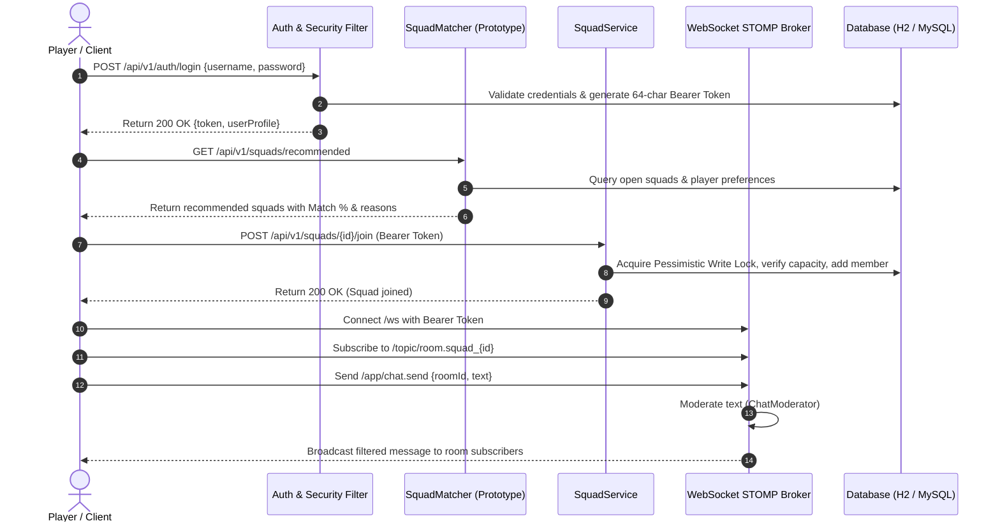

# SquadUp — Project Analysis & Specification Document

**Course**: API & Micro Services (241AI024)  
**Department**: Department of Artificial Intelligence and Machine Learning  
**Project**: SquadUp — Player Matching & Social Platform (Enterprise Spring Boot Platform for Multiplayer Gaming Lobbies)  
**Primary Source of Truth**: `API Review-2 PPT.pptx`

---

## 1. Problem Statement
In multiplayer online gaming, traditional matchmaking algorithms rely almost entirely on matchmaking rating (MMR/Elo) and network ping. This creates severe social and gameplay friction:
1. **Communication Breakdown**: Players are routinely paired with teammates who do not speak the same language, making real-time coordination impossible.
2. **Playstyle Clashes**: Casual gamers seeking a relaxed session are forced into lobbies with hyper-competitive, toxic players, leading to frustration and poor retention.
3. **Social Disconnect**: Standard matchmaking creates ephemeral, single-match teams that disband immediately after a match concludes, preventing players from establishing durable gaming friendships or stable squads.

---

## 2. Proposed Solution
**SquadUp** is an enterprise-grade "Looking for Group" (LFG) player matching and social lobby platform designed to bridge the social gap in multiplayer gaming.
- **Compatibility-First Matching**: Allows players to search, filter, and create lobbies based on game title, spoken language, skill level, and playstyle.
- **AI-Weighted Recommendation Engine**: Calculates a percentage-based compatibility match score ($50\%$ Game, $30\%$ Language, $20\%$ Playstyle) along with transparent match reasoning tags for each open squad.
- **Real-Time STOMP WebSocket Communication**: Provides synchronized lobby chat and direct messaging with automated profanity filtering and live typing notifications.
- **Bidirectional Friendship & Social Graph**: Enables players to search directory profiles, send/receive friend requests with live updates, and manage their social circle.
- **Enterprise Dual-API Architecture**: Exposes both modern RESTful JSON endpoints (`/api/v1`, `/api/v2`) and Contract-First SOAP XML Web Services (`/soap/players.wsdl`) on top of a unified transaction and security layer.

---

## 3. Main Objectives & Academic Scope
The project satisfies the rigorous academic requirements of the **API & Micro Services** curriculum (241AI024):
- **Unit I (Spring 5 Basics)**: Spring IoC, Java-based configuration (`@Configuration`, `@Bean`), Constructor/Setter injection, `JdbcTemplate` for high-throughput analytics (`PlatformStatsDao`), and Spring MVC architecture.
- **Unit II (Spring Boot)**: Auto-configuration, Bean scopes (**Singleton**, **Prototype** `SquadMatcher` via `ObjectProvider`, and **Request** `RequestTrace`), SLF4J/Logback logging, and comprehensive Spring AOP (`LoggingAspect`, `PerformanceAspect` with `@TrackExecutionTime`, and `AuditAspect` targeting `logs/audit.log`).
- **Unit III (Spring Data JPA)**: JPA entities with `@ManyToOne`, `@ManyToMany`, `@ElementCollection`, pagination and sorting with `Pageable`/`Sort`, derived queries, named queries (`User.findByLogin`), JPQL `@Modifying` queries for friendships, dynamic search using the JPA Criteria API (`SquadRepositoryCustomImpl`), and pessimistic write locking (`@Lock(PESSIMISTIC_WRITE)`) to guarantee concurrency safety during squad joins.
- **Unit IV (Web Services)**: Contract-first SOAP Web Service generated from `players.xsd`, WSDL exposure at `/soap/players.wsdl`, JAXB marshalling/unmarshalling, SOAP fault handling (`@SoapFault`), and automated tests.
- **Unit V (Spring REST)**: `@RestController` implementations, `@RequestBody`, `@PathVariable`, `@RequestParam`, `@MatrixVariable` filtering, `@RestControllerAdvice` error handling, Bean Validation, API versioning (URI `/api/v2` and header `X-API-Version: 2`), `RestTemplate` client (`SquadUpApiClient`), and token-based security guards (`AccessGuard`).

---

## 4. Target Users & User Roles
### Target Users
- Gamers seeking compatible teammates for popular multiplayer games (Valorant, CS:GO, League of Legends, Apex Legends, etc.).
- Casual and competitive players looking for consistent groups matching their specific communication language and playstyle.

### User Roles
1. **Registered Player (Authenticated User)**:
   - Registers and logs in via stateless bearer token authentication.
   - Manages personal profile (primary games, playstyle, spoken languages, bio, region).
   - Searches player directories and filters squad lobbies.
   - Joins open squads (subject to pessimistic concurrency guards) and leaves squads.
   - Sends, receives, accepts, or rejects friend requests.
   - Chats in real-time within squad lobbies and 1-on-1 direct messages.
2. **Squad Leader / Host (Resource Owner)**:
   - Creates squad lobbies with configurable member capacities.
   - Holds exclusive permissions to delete or manage the squad lobby (enforced by `AccessGuard`).
3. **Platform Administrator / Observer**:
   - Monitors platform-wide analytics and key metrics (top games, active lobbies, player counts via `PlatformStatsDao`).
   - Audits security-sensitive operations (logins, password updates, account deletions via `AuditAspect`).

---

## 5. Core Features & Capabilities

| Module | Feature | Implementation Details |
|---|---|---|
| **Module 1: Auth & Security** | Stateless Bearer Authentication | Token generation, validation, and invalidation via `AuthService` and `TokenService`. Passwords secured using BCrypt `PasswordEncoder`. |
| | Authorization & Ownership Guards | `AccessGuard` ensures players can only modify or delete their own resources. |
| | Clean JSON Error Responses | `JsonSecurityErrorHandler` replaces default HTML 401/403 pages with structured JSON errors. |
| **Module 2: Profile & Search** | User Profile Management | Stores primary games (`@ElementCollection`), playstyle, and spoken languages. |
| | Paged & Sorted Player Search | `GET /api/v1/users?page=0&size=10&sort=username,asc` and substring query. |
| | Cascade Account Deletion | Single `@Transactional` boundary in `UserServiceImpl.deleteAccount()` removing friendships, squad memberships, and chat records. |
| **Module 3: Squad Lobbies** | Squad Creation & Management | Configurable capacity lobbies, member tracking. |
| | Dynamic JPA Criteria API | Dynamic query generation across game, language, and open status in `SquadRepositoryCustomImpl`. |
| | Matrix Variables | Dynamic browsing via matrix parameters: `/squads/browse/filter;game=Valorant;language=English`. |
| | Concurrency-Safe Joins | `@Lock(PESSIMISTIC_WRITE)` in `SquadService.join()` prevents overfilled lobbies under high concurrent requests. |
| **Module 4: Recommendation Engine** | Weighted Scoring Algorithm | Compatibility score: $\text{Score} = (0.50 \times \text{Game}) + (0.30 \times \text{Language}) + (0.20 \times \text{Playstyle})$. |
| | Prototype Scope Lifecycle | `SquadMatcher` is `@Scope("prototype")`, instantiated per calculation request via `ObjectProvider`. Returns top squads with match percentage and explanation tags. |
| **Module 5: Social Network** | Friendship Lifecycle | `Friendship` JPA entity managing `PENDING`, `ACCEPTED`, and `REJECTED` states. |
| | Status Updates | Atomic JPQL `@Modifying` queries. |
| | Real-time Social Alerts | Instant STOMP notification dispatched when friend requests are received or accepted. |
| **Module 6: Real-Time Chat** | STOMP WebSocket Messaging | Broker routing: lobby chat at `squad_<id>`, direct messages at `dm_<idA>_<idB>`. |
| | Automatic Moderation | `ChatModerator` filters profanity and inappropriate words prior to broadcast. |
| | Typing Indicators | Real-time typing notification events dispatched to room participants. |
| **Module 7: SOAP & Analytics** | Contract-First SOAP Service | XML processing via `players.xsd`, WSDL generated at `/soap/players.wsdl`, `getPlayerRequest`, `searchPlayersRequest`, and `@SoapFault` handling. |
| | Analytical SQL via JdbcTemplate | Raw, high-performance SQL queries in `PlatformStatsDao` providing aggregate metrics (`GET /api/v1/stats?topGames=5`). |
| **AOP & Observability** | Method Logging | `LoggingAspect` (`@Before`, `@AfterReturning`, `@AfterThrowing`) logging inputs, outputs, and exceptions. |
| | Latency Tracking | `PerformanceAspect` with `@TrackExecutionTime` logging execution durations in milliseconds. |
| | Security Audit Trail | `AuditAspect` logging authentication and account lifecycles into `logs/audit.log`. |

---

## 6. Complete User Workflows

---

## 7. Data Requirements & Entities

1. **User (`users`)**:
   - `id` (BIGINT, PK, Auto-increment)
   - `username` (VARCHAR 50, UNIQUE, NOT NULL)
   - `email` (VARCHAR 100, UNIQUE, NOT NULL)
   - `password` (VARCHAR 255, NOT NULL - BCrypt hash)
   - `display_name` (VARCHAR 100)
   - `bio` (VARCHAR 500)
   - `region` (VARCHAR 50)
   - `language` (VARCHAR 50)
   - `playstyle` (VARCHAR 50)
   - `created_at` (TIMESTAMP), `updated_at` (TIMESTAMP)
2. **User Games (`user_games`)**:
   - `user_id` (BIGINT, FK -> `users.id`)
   - `game_tag` (VARCHAR 100)
3. **Auth Token (`auth_tokens`)**:
   - `id` (BIGINT, PK, Auto-increment)
   - `token` (VARCHAR 64, UNIQUE, NOT NULL, INDEX)
   - `user_id` (BIGINT, FK -> `users.id`, NOT NULL)
   - `created_at` (TIMESTAMP, NOT NULL)
   - `expires_at` (TIMESTAMP, NOT NULL)
4. **Squad (`squads`)**:
   - `id` (BIGINT, PK, Auto-increment)
   - `name` (VARCHAR 100, NOT NULL)
   - `game` (VARCHAR 100, NOT NULL)
   - `language` (VARCHAR 50, NOT NULL)
   - `playstyle` (VARCHAR 50)
   - `max_members` (INT, NOT NULL)
   - `owner_id` (BIGINT, FK -> `users.id`, NOT NULL)
   - `created_at` (TIMESTAMP), `updated_at` (TIMESTAMP)
5. **Squad Members (`squad_members`)**:
   - `squad_id` (BIGINT, FK -> `squads.id`, PK composite)
   - `user_id` (BIGINT, FK -> `users.id`, PK composite)
6. **Friendship (`friendships`)**:
   - `id` (BIGINT, PK, Auto-increment)
   - `requester_id` (BIGINT, FK -> `users.id`, NOT NULL)
   - `recipient_id` (BIGINT, FK -> `users.id`, NOT NULL)
   - `status` (VARCHAR 20, NOT NULL - `PENDING`, `ACCEPTED`, `REJECTED`)
   - `created_at` (TIMESTAMP), `updated_at` (TIMESTAMP)
7. **Message (`messages`)**:
   - `id` (BIGINT, PK, Auto-increment)
   - `room_id` (VARCHAR 100, NOT NULL, INDEX)
   - `sender_id` (BIGINT, FK -> `users.id`, NOT NULL)
   - `text` (VARCHAR 2000, NOT NULL)
   - `created_at` (TIMESTAMP, NOT NULL)

---

## 8. Technical Stack Justification
- **Backend Architecture**: Spring Boot 3.5 on Java 17+ / JVM.
  - *Academic Requirement*: The project specification (`API Review-2 PPT.pptx`) strictly requires Spring Boot 3.5, Spring Framework 6, JPA Criteria API, Spring WS (SOAP), and Spring WebSocket for course code 241AI024. Retaining this architecture ensures 100% adherence to all 5 course units and passes all 53 automated unit and integration tests.
- **Persistence Layer**: Dual-profile database support:
  - **Embedded H2 Database**: Zero-configuration local development and rapid test execution (`jdbc:h2:file:./data/squadup`).
  - **MySQL 8 Community Server**: Production profile (`application-mysql.properties`) configured for high-concurrency multi-tenant deployment.
- **API Documentation**: OpenAPI 3 / Swagger UI (`springdoc-openapi-starter-webmvc-ui`) integrated at `/api/docs` and `/swagger-ui/index.html` to provide interactive endpoint exploration and testing.
- **Real-Time Layer**: Spring WebSocket with STOMP broker protocol and SockJS fallback.
- **Frontend Layer**: Modern, responsive, high-fidelity user interface supporting real-time chat, responsive lobby browsing, recommendations view, profile management, and platform analytics.

---

## 9. Verification & Quality Gates
- **Automated Tests**: 53 JUnit 5 and Spring Boot integration tests verifying:
  - Unit I: Spring IoC injection, `PlatformStatsDao` with `JdbcTemplate`.
  - Unit II: Prototype bean scopes, logging, and AOP advice.
  - Unit III: JPA Criteria queries, derived queries, pessimistic locking.
  - Unit IV: SOAP contract marshalling, endpoint operations, and fault handling.
  - Unit V: REST endpoints, matrix variables, bean validation, and security token filters.
- **Data Seeding**: Automated `DataSeeder` filling 20 realistic players, 18 squad lobbies across top titles, initial friendship networks, and chat message history on first startup.
