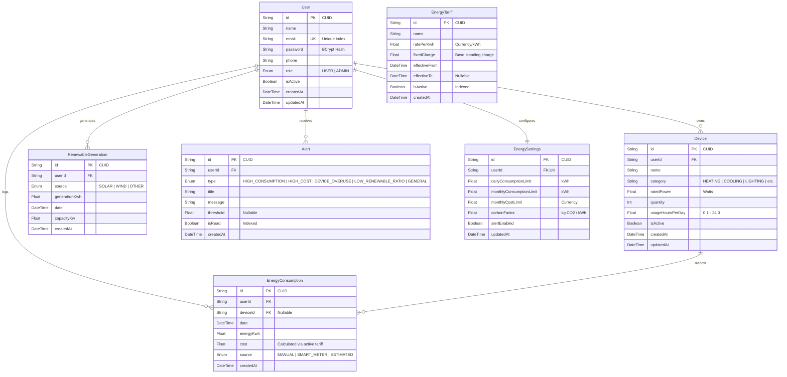

# 🌿 Green Grid — Smart Energy Management & Sustainability Platform

[](https://www.typescriptlang.org/)
[](https://nodejs.org/)
[](https://expressjs.com/)
[](https://react.dev/)
[](https://vitejs.dev/)
[](https://tailwindcss.com/)
[](https://www.prisma.io/)
[](https://www.postgresql.org/)
[](http://localhost:5000/api/docs)
[](LICENSE)

**Green Grid** is an enterprise-grade, full-stack smart energy management and sustainability platform. It empowers homeowners, businesses, and platform administrators to monitor electrical consumption, track renewable energy generation, dynamically calculate costs based on utility tariffs, detect high-consumption anomalies, lower carbon emissions, and act on personalized, data-driven conservation recommendations.

---

## 📑 Table of Contents

1. [Key Features](#-key-features)
2. [System Architecture](#-system-architecture)
3. [Database Architecture & Data Models](#-database-architecture--data-models)
4. [Technology Stack](#-technology-stack)
5. [Mathematical & Business Rules](#-mathematical--business-rules)
6. [API Architecture & Endpoints](#-api-architecture--endpoints)
7. [Security Architecture](#-security-architecture)
8. [Directory Structure](#-directory-structure)
9. [Getting Started & Local Setup](#-getting-started--local-setup)
10. [Demo Login Accounts](#-demo-login-accounts)
11. [Testing & Quality Assurance](#-testing--quality-assurance)
12. [Docker Deployment](#-docker-deployment)

---

## 🌟 Key Features

### 🔌 Appliance & Device Inventory
- Register household and industrial appliances with rated wattage, quantity, category, and daily usage hours.
- Automatic computation of daily, monthly, and annual baseline kWh consumption.

### ⚡ Consumption Tracking & Cost Calculation
- Ingest electricity consumption logs with categorization (`MANUAL`, `SMART_METER`, `ESTIMATED`).
- Automatic real-time cost computation mapped against the system's active utility tariff.
- Multi-dimensional filters (date ranges, specific devices, sources) with server-side pagination.

### ☀️ Renewable Energy Integration
- Log on-site solar photovoltaic (PV) and wind generation metrics.
- Calculate self-consumption ratios and net grid dependence:
  $$\text{Self-Reliance \%} = \min\left(100, \frac{\sum \text{Renewable Generation (kWh)}}{\sum \text{Total Consumption (kWh)}} \times 100\right)$$

### 📊 Interactive Visual Analytics (Recharts)
- **30-Day Daily Timeline**: Side-by-side comparison of grid consumption vs. renewable generation.
- **Weekly & Monthly Rollups**: Aggregated trend bars and billing trajectories.
- **Appliance Share Ranking**: Category-wise consumption breakdown and pie distributions.
- **Carbon Footprint & Abatement**: Track total greenhouse gas emissions ($\text{kg CO}_2\text{e}$) alongside clean energy offsets.

### 💡 Algorithmic Recommendation Engine
- Generates dynamic, data-driven energy conservation recommendations derived from actual usage records:
  - **Heating & Cooling Optimization**: Detects HVAC overuse (>35% of total consumption).
  - **Lighting Efficiency**: Recommends LED transitions for high-hour incandescent/halogen loads.
  - **Phantom Load Mitigation**: Identifies continuous baseline standby drain.
  - **Renewable Load Shifting**: Prompts shifting flexible appliance usage to peak solar generation hours.

### 🔔 Automated Threshold Alerts & Anomaly Detection
- Daily consumption threshold breaches (`HIGH_CONSUMPTION`).
- Projected monthly cost overrun warnings (`HIGH_COST`).
- Unread notification badge count and dismiss/read lifecycle.

### 📑 Reports & CSV Export
- Generate on-demand date-range energy performance summaries.
- One-click export of complete consumption data streams as downloadable CSV files.

### 🛡️ Administrative Cockpit (`ADMIN` Role)
- Platform-wide macro telemetry: system kWh, total renewable generation, collective carbon offset.
- User directory with status toggles (`isActive: true/false`) and detailed appliance audits.
- Energy tariff management: configure base fixed charges and per-kWh rates with instant activation.

---

## 🏗️ System Architecture

Green Grid follows a clean, decoupled **Layered Client-Server Architecture** designed for high throughput, strict type safety, and clear separation of concerns.

```
                      ┌──────────────────────────────────────────┐
                      │            Web Browser Client            │
                      │   (React 18 + Vite + Tailwind + Lucide)   │
                      └────────────────────┬─────────────────────┘
                                           │
                                HTTPS / REST (JSON)
                                 Bearer JWT Token
                                           │
                                           ▼
┌──────────────────────────────────────────────────────────────────────────────────┐
│                             Express Backend API (5000)                           │
│                                                                                  │
│  ┌────────────────────────────────────────────────────────────────────────────┐  │
│  │ Security & Network Middlewares                                              │  │
│  │ ├─ Helmet (Secure HTTP Headers)          ├─ CORS (Configured Client Origin) │  │
│  │ ├─ Morgan (HTTP Request Logging)         ├─ Express Rate Limiter            │  │
│  └─────────────────────────────────────┬──────────────────────────────────────┘  │
│                                        │                                         │
│  ┌─────────────────────────────────────▼──────────────────────────────────────┐  │
│  │ Router & Route Guard Middlewares                                           │  │
│  │ ├─ authenticateJWT (Stateless Bearer Verification)                         │  │
│  │ ├─ requireAdmin (Role-Based Authorization - RBAC)                          │  │
│  │ └─ validateRequest / validateQuery (Zod Schema Validation)                 │  │
│  └─────────────────────────────────────┬──────────────────────────────────────┘  │
│                                        │                                         │
│  ┌─────────────────────────────────────▼──────────────────────────────────────┐  │
│  │ Controller Layer (HTTP Request/Response Envelopes)                         │  │
│  │ ├─ AuthController         ├─ DeviceController     ├─ ConsumptionController │  │
│  │ ├─ RenewableController    ├─ AnalyticsController  ├─ RecommendationCtrl    │  │
│  │ ├─ AlertController        ├─ SettingsController   ├─ AdminController       │  │
│  └─────────────────────────────────────┬──────────────────────────────────────┘  │
│                                        │                                         │
│  ┌─────────────────────────────────────▼──────────────────────────────────────┐  │
│  │ Domain Service Layer (Business Logic & Calculations)                       │  │
│  │ ├─ Tariff Calculation Engine             ├─ Recommendation Algorithms      │  │
│  │ ├─ Carbon Factor Computation             ├─ Threshold Evaluation & Alerts  │  │
│  │ ├─ Data Aggregation (Daily/Weekly/Monthly)├─ CSV Stream Serializer          │  │
│  └─────────────────────────────────────┬──────────────────────────────────────┘  │
│                                        │                                         │
│  ┌─────────────────────────────────────▼──────────────────────────────────────┐  │
│  │ Persistence Layer (Prisma 6 ORM)                                           │  │
│  │ └─ Type-safe queries, composite indexes, connection pooling, transactions  │  │
│  └─────────────────────────────────────┬──────────────────────────────────────┘  │
└────────────────────────────────────────┼─────────────────────────────────────────┘
                                         │
                                         ▼
                      ┌──────────────────────────────────────────┐
                      │       PostgreSQL 16+ Database (5432)     │
                      │  Users, Devices, Consumptions, Tariffs,   │
                      │  Renewables, Alerts, Settings            │
                      └──────────────────────────────────────────┘
```

### Architectural Principles
1. **Stateless Authorization**: All protected endpoints require a cryptographically signed Bearer JWT token.
2. **End-to-End Type Safety**: Shared TypeScript interfaces ensure synchronization between database schemas, backend DTOs, and frontend components.
3. **Fail-Fast Request Validation**: Every incoming payload is validated against strict Zod schemas before touching service methods.
4. **Tenant Isolation**: Non-admin database queries enforce `userId: req.user.id` to guarantee zero data leakage between users.
5. **Centralized Error Handling**: Unified error handling middleware formats structured responses (`code`, `message`, `details`) and shields stack traces from exposure in production.

---

## 🗄️ Database Architecture & Data Models

Green Grid uses **PostgreSQL** managed through **Prisma ORM**. All foreign keys enforce cascade deletion to ensure referential integrity.

### Entity Relationship Diagram (ERD)



### Indexing & Performance Strategy
- **Chronological Queries**: Composite index `@@index([userId, date])` on both `EnergyConsumption` and `RenewableGeneration` ensures sub-millisecond timeline range queries.
- **Notification Badges**: Composite index `@@index([userId, isRead])` on `Alert` allows rapid unread counters.
- **Fast Lookups**: Unique indexes on `User.email` and `EnergySettings.userId`.
- **Active Tariffs**: Index on `EnergyTariff.isActive` enables immediate active tariff retrieval during ingestion.

---

## 💻 Technology Stack

| Layer | Technology | Version | Purpose |
|---|---|---|---|
| **Frontend Runtime** | React | 18.3 | Declarative, component-driven user interface |
| **Build & Bundler** | Vite | 6.2 | Fast dev server with Hot Module Replacement (HMR) |
| **Language (Full-Stack)** | TypeScript | 5.8 | End-to-end compile-time type safety |
| **Styling & System** | Tailwind CSS | 3.4 | Utility-first responsive design system |
| **Data Visualization** | Recharts | 2.15 | Responsive SVG charts (Line, Bar, Area, Pie) |
| **Icons** | Lucide React | 0.475 | Clean, modern iconography |
| **Client Form Validation** | React Hook Form + Zod | 7.54 / 3.24 | Performant uncontrolled forms with type-safe schemas |
| **HTTP Client** | Axios | 1.7 | Promise-based client with Bearer token interceptors |
| **Backend Runtime** | Node.js | 22+ | Non-blocking, asynchronous JavaScript runtime |
| **API Framework** | Express.js | 4.21 | RESTful routing, middleware chaining, and HTTP dispatch |
| **Database ORM** | Prisma | 6.4 | Type-safe query builder, schema migrations, and seeding |
| **Database Engine** | PostgreSQL | 16 / 18 | Relational database with ACID transactions |
| **Authentication** | JWT + BCrypt.js | 9.0 / 3.0 | Stateless JSON Web Tokens & salted password hashing |
| **Security Headers** | Helmet | 8.0 | Configures HTTP security headers (CSP, XSS, Sniffing) |
| **Rate Limiter** | express-rate-limit | 7.5 | Brute-force protection & request throttling |
| **API Documentation** | Swagger / OpenAPI 3.0 | 6.2 / 5.0 | Interactive interactive web API tester at `/api/docs` |
| **Automated Testing** | Jest + Supertest | 29.7 / 7.0 | Integration and unit testing suite |
| **Process Orchestration** | Concurrently | 9.1 | Runs backend and frontend in a unified terminal session |

---

## 📐 Mathematical & Business Rules

### 1. Appliance Consumption Model
$$\text{Daily kWh} = \frac{\text{ratedPower (Watts)} \times \text{quantity} \times \text{usageHoursPerDay}}{1000}$$

### 2. Dynamic Tariff Cost Model
$$\text{Cost} = \text{energyKwh} \times \text{activeTariff.ratePerKwh}$$
*(Monthly fixed charges are added to period bill rollups.)*

### 3. Renewable Self-Reliance Coverage
$$\text{Self-Reliance \%} = \min\left(100, \frac{\sum_{i=1}^{n} \text{Renewable Generation (kWh)}_i}{\sum_{i=1}^{n} \text{Total Consumption (kWh)}_i} \times 100\right)$$

### 4. Carbon Footprint & Offset Quantification
- **Grid Carbon Produced**:
  $$\text{Emissions (kg CO}_2\text{e)} = \text{Total Grid Consumption (kWh)} \times \text{carbonFactor}$$
- **Green Carbon Avoided**:
  $$\text{Carbon Offset (kg CO}_2\text{e)} = \text{Total Renewable Generation (kWh)} \times \text{carbonFactor}$$
*(Default grid carbon intensity: $0.82\text{ kg CO}_2\text{/kWh}$, user-configurable in settings.)*

---

## 🔌 API Architecture & Endpoints

All API endpoints are prefixed with `/api` and return standardized JSON envelopes. Interactive Swagger documentation is available at **`http://localhost:5000/api/docs`**.

### Standard Envelopes

#### Success Response (`200 OK`, `201 Created`)
```json
{
  "success": true,
  "message": "Operation successful",
  "data": { ... }
}
```

#### Error Response (`400`, `401`, `403`, `404`, `500`)
```json
{
  "success": false,
  "message": "Validation failed",
  "error": {
    "code": "VALIDATION_ERROR",
    "details": [ ... ]
  }
}
```

### Endpoints Reference

| Method | Endpoint | Access | Description |
|---|---|---|---|
| **AUTH** | | | |
| `POST` | `/api/auth/register` | Public | Register new user account |
| `POST` | `/api/auth/login` | Public | Authenticate user & return Bearer JWT token |
| `GET` | `/api/auth/me` | Authenticated | Retrieve current user profile & role |
| `POST` | `/api/auth/logout` | Authenticated | Terminate client-side session |
| **USERS** | | | |
| `GET` | `/api/users/me` | Authenticated | Get full profile, preferences, & thresholds |
| `PUT` | `/api/users/me` | Authenticated | Update name and contact phone |
| `PUT` | `/api/users/me/password` | Authenticated | Change account password |
| **DEVICES** | | | |
| `GET` | `/api/devices` | Authenticated | List registered appliances with daily kWh |
| `POST` | `/api/devices` | Authenticated | Register new electrical device |
| `GET` | `/api/devices/:id` | Authenticated | Fetch specific device details |
| `PUT` | `/api/devices/:id` | Authenticated | Modify device power or usage hours |
| `DELETE` | `/api/devices/:id` | Authenticated | Remove device from inventory |
| **CONSUMPTION** | | | |
| `GET` | `/api/consumption` | Authenticated | Paginated history (`startDate`, `endDate`, `deviceId`, `source`) |
| `POST` | `/api/consumption` | Authenticated | Log consumption record (auto-calculates cost) |
| `GET` | `/api/consumption/:id` | Authenticated | Single consumption record |
| `PUT` | `/api/consumption/:id` | Authenticated | Edit consumption record |
| `DELETE` | `/api/consumption/:id` | Authenticated | Delete consumption record |
| **RENEWABLES** | | | |
| `GET` | `/api/renewable` | Authenticated | List renewable solar/wind generation entries |
| `POST` | `/api/renewable` | Authenticated | Record solar or wind generation |
| `GET` | `/api/renewable/:id` | Authenticated | Single renewable record |
| `PUT` | `/api/renewable/:id` | Authenticated | Edit renewable record |
| `DELETE` | `/api/renewable/:id` | Authenticated | Remove renewable record |
| **ANALYTICS** | | | |
| `GET` | `/api/analytics/summary` | Authenticated | Key KPI metrics (today's usage, month-to-date, costs, carbon) |
| `GET` | `/api/analytics/daily` | Authenticated | 30-day chronological daily usage & solar breakdown |
| `GET` | `/api/analytics/weekly` | Authenticated | Weekly aggregated consumption |
| `GET` | `/api/analytics/monthly` | Authenticated | Monthly consumption and bill trajectories |
| `GET` | `/api/analytics/devices` | Authenticated | Appliance consumption rankings and percentage shares |
| `GET` | `/api/analytics/renewable` | Authenticated | Renewable generation vs. grid consumption trend |
| `GET` | `/api/analytics/carbon` | Authenticated | Carbon emissions history vs. clean energy offsets |
| **RECOMMENDATIONS** | | | |
| `GET` | `/api/recommendations` | Authenticated | Algorithmic energy-saving advice from stored usage |
| **ALERTS** | | | |
| `GET` | `/api/alerts` | Authenticated | User notifications with unread counter |
| `PUT` | `/api/alerts/:id/read` | Authenticated | Mark alert as read |
| `DELETE` | `/api/alerts/:id` | Authenticated | Dismiss/delete alert |
| **SETTINGS** | | | |
| `GET` | `/api/settings` | Authenticated | Read limits (`dailyConsumptionLimit`, `monthlyCostLimit`, etc.) |
| `PUT` | `/api/settings` | Authenticated | Update energy thresholds and carbon factor |
| **REPORTS** | | | |
| `GET` | `/api/reports/energy` | Authenticated | Period performance report with key metrics |
| `GET` | `/api/reports/energy/export` | Authenticated | Download complete consumption history as CSV |
| **ADMIN COCKPIT** | | | |
| `GET` | `/api/admin/dashboard` | Admin Only | Platform-wide macro KPIs, user counts, energy balance |
| `GET` | `/api/admin/users` | Admin Only | Searchable, paginated user directory |
| `GET` | `/api/admin/users/:id` | Admin Only | Comprehensive user audit with device inventory |
| `PUT` | `/api/admin/users/:id/status` | Admin Only | Toggle user activation (`isActive: boolean`) |
| `GET` | `/api/admin/analytics` | Admin Only | Global platform energy trends |
| `GET` | `/api/admin/alerts` | Admin Only | Platform-wide alert telemetry |
| `GET` | `/api/admin/tariffs` | Admin Only | List all active and historical energy tariffs |
| `POST` | `/api/admin/tariffs` | Admin Only | Create and activate a new utility tariff |

---

## 🔒 Security Architecture

1. **Cryptographic Password Hashing**: Passwords are encrypted using BCrypt with 10 salt rounds. Plaintext passwords or hashes are never returned in responses.
2. **Stateless JWT Authorization**: Tokens expire after a configurable duration (`7d` default). Each request decodes `userId` and `role`.
3. **Role-Based Access Control (RBAC)**: All administrative routes (`/api/admin/*`) pass through the `requireAdmin` middleware, which issues `403 Forbidden` for standard users.
4. **Tenant Isolation**: Non-admin CRUD operations enforce `userId: req.user.id` on every query, preventing unauthorized cross-user access.
5. **Runtime Input Validation**: Every endpoint validates input bodies, params, and queries with Zod schemas to reject malformed data before execution.
6. **HTTP Security Headers**: Helmet protects against cross-site scripting (XSS), clickjacking, MIME-type sniffing, and insecure transport.
7. **Rate Limiting**: Configured with `express-rate-limit` to prevent brute-force attacks and denial-of-service abuse.

---

## 📁 Directory Structure

```
GreenGrid/
├── package.json                   # Root monorepo workspace scripts
├── package-lock.json
├── docker-compose.yml             # PostgreSQL container definition
├── start.bat                      # Windows one-click startup script
├── .gitignore                     # Git ignore rules (builds, node_modules, .env, archives)
├── README.md                      # Comprehensive platform documentation
├── ARCHITECTURE.md                # System architecture specification
├── DATABASE_SCHEMA.md             # Prisma database schema documentation
├── API_DOCUMENTATION.md           # API reference & response envelope guides
├── SECURITY.md                    # Security architecture & RBAC matrix
├── TESTING.md                     # Test strategy & test execution guide
├── TEAM_DEVELOPMENT.md            # Team conventions & branch workflows
├── scripts/
│   └── ensure-db.js               # Auto-detects and launches PostgreSQL if offline
├── server/                        # Express + TypeScript Backend
│   ├── package.json
│   ├── tsconfig.json
│   ├── jest.config.js
│   ├── .env.example
│   ├── prisma/
│   │   ├── schema.prisma          # PostgreSQL relational schema
│   │   └── seed.ts                # Database seeder (Admin, Users, 30 days metrics)
│   ├── src/
│   │   ├── server.ts              # HTTP server entry point & graceful shutdown
│   │   ├── app.ts                 # Express middleware configuration
│   │   ├── config/
│   │   │   ├── env.ts             # Type-safe environment variable parsing
│   │   │   ├── prisma.ts          # Singleton Prisma client instance
│   │   │   └── swagger.ts         # OpenAPI/Swagger JSDoc specifications
│   │   ├── middleware/
│   │   │   ├── auth.ts            # authenticateJWT & requireAdmin guards
│   │   │   ├── validate.ts        # Zod schema validation middleware
│   │   │   └── errorHandler.ts    # Centralized global error handler
│   │   ├── controllers/           # HTTP handlers (Auth, Device, Analytics, etc.)
│   │   ├── services/              # Domain logic, calculators, database operations
│   │   ├── validators/            # Zod input validation schemas
│   │   ├── routes/                # Express router declarations
│   │   ├── types/                 # Shared TypeScript interfaces & types
│   │   └── utils/
│   │       └── calculator.ts      # Energy, cost, renewable, and carbon formulas
│   └── tests/
│       └── api.test.ts            # Integration test suite (23 test cases)
└── client/                        # React 18 + Vite + Tailwind Frontend
    ├── package.json
    ├── tsconfig.json
    ├── vite.config.ts
    ├── index.html
    └── src/
        ├── main.tsx               # Client entry point
        ├── App.tsx                # Client routing & layout wrapper
        ├── index.css              # Global styles & Tailwind directives
        ├── api/
        │   └── client.ts          # Axios instance with Bearer token interceptor
        ├── context/
        │   └── AuthContext.tsx    # React authentication provider & state
        ├── components/
        │   ├── layout/            # Navbar, Sidebar, Footer, PageHeader
        │   └── ui/                # MetricCard, Modal, Badge, Button, Input
        ├── pages/
        │   ├── auth/              # Login & Register views
        │   ├── dashboard/         # Real-time overview & KPI summary
        │   ├── devices/           # Appliance inventory & wattage manager
        │   ├── consumption/       # Energy logs, smart meter ingest, history
        │   ├── renewable/         # Solar/wind generation tracking
        │   ├── analytics/         # Recharts charts (Daily, Weekly, Monthly, Devices)
        │   ├── recommendations/   # Algorithmic energy-saving insights
        │   ├── alerts/            # Notification center & threshold alerts
        │   ├── reports/           # Date-range reports & CSV export
        │   ├── settings/          # Threshold limits & carbon factor configuration
        │   ├── profile/           # User credentials & password update
        │   └── admin/             # Platform overview, user control, tariff editor
        └── types/                 # Frontend TypeScript interfaces
```

---

## ⚡ Getting Started & Local Setup

### 1. Prerequisites
- **Node.js**: `v18.0.0` or higher (tested on Node `v22` & `v25`)
- **PostgreSQL**: PostgreSQL 16+ running locally, or **Docker**

### 2. Configure Environment
Create a `.env` file inside the `server/` directory:
```bash
cp .env.example server/.env
```

Ensure `server/.env` contains your database connection string and JWT secret:
```env
DATABASE_URL="postgresql://postgres@localhost:5432/greengrid?schema=public"
JWT_SECRET="greengrid_super_secret_jwt_key_2026_production_grade"
JWT_EXPIRES_IN="7d"
PORT=5000
NODE_ENV="development"
CLIENT_URL="http://localhost:5173"
DEFAULT_CARBON_FACTOR=0.82
DEFAULT_TARIFF_RATE=7.50
DEFAULT_FIXED_CHARGE=125.00
```

### 3. Initialize Database & Seed
Push the Prisma schema to create the PostgreSQL tables and run the seeder:
```bash
npm run prisma:push
npm run prisma:seed
```

### 4. Start the Application
Run both the Backend API and React Frontend concurrently:
```bash
npm run dev
```

*Or launch independently:*
```bash
npm run dev:server   # Starts Express backend on http://localhost:5000
npm run dev:client   # Starts React frontend on http://localhost:5173
```

*(On Windows, you can also double-click `start.bat` for an automated launcher).*

### 5. Access Endpoints
- **Frontend Application**: [http://localhost:5173](http://localhost:5173)
- **Backend API**: [http://localhost:5000/api](http://localhost:5000/api)
- **Health Endpoint**: [http://localhost:5000/health](http://localhost:5000/health)
- **Swagger Documentation**: [http://localhost:5000/api/docs](http://localhost:5000/api/docs)

---

## 🔑 Demo Login Accounts

The database seeder pre-populates the platform with realistic accounts and 30 days of historical energy data:

| Role | Email | Password | Profile Summary |
|---|---|---|---|
| **Platform Administrator** | `admin@greengrid.com` | `Admin@123` | Full access to Admin Cockpit, macro platform analytics, user directory, and tariff creation |
| **Normal User (Eco Pro)** | `alex@greengrid.com` | `User@123` | Active solar generation, 7 appliances (HVAC, Refrigerator, EV Charger, etc.), 30 days of metrics, alerts |
| **Normal User** | `sam@greengrid.com` | `User@123` | Smart-meter tracking, AC, water pump, baseline domestic consumption |
| **Normal User (Prosumer)** | `jordan@greengrid.com` | `User@123` | High renewable prosumer with high solar self-reliance |

---

## 🧪 Testing & Quality Assurance

The backend includes a comprehensive integration test suite built with **Jest** and **Supertest** covering:
- Authentication & JWT token validation
- Device CRUD and daily kWh calculation formulas
- Consumption logging, dynamic tariff cost assignment, and pagination
- Renewable generation logging and self-consumption calculations
- Analytics summary, daily rollups, and recommendation algorithms
- Alerts, notification badge counts, and dismiss flows
- CSV export streaming
- RBAC permissions (verifying non-admins receive `403 Forbidden` on admin endpoints)
- Cascade deletion integrity

Run the test suite:
```bash
npm run test
```

---

## 🐳 Docker Deployment

To run PostgreSQL via Docker Compose:
```bash
docker compose up -d
```

To stop the container:
```bash
docker compose down
```

---

## 📄 License

This project is licensed under the MIT License. See [LICENSE](LICENSE) for details.
